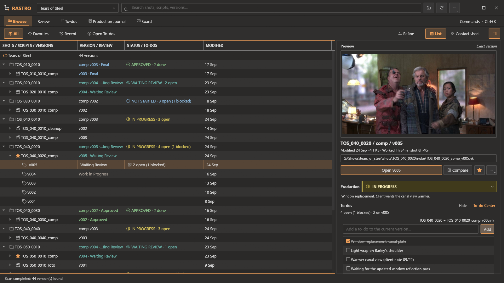
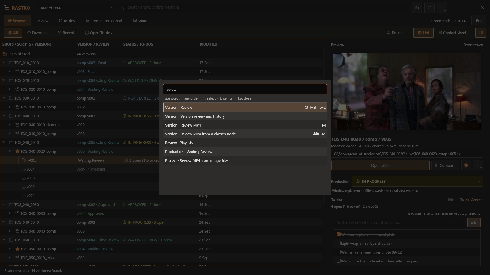

# Rastro

Rastro keeps a compositor's shots in one window: every project, shot and version on disk, with
thumbnails, to-dos, production status, a production journal, side-by-side compare, review MP4s and
delivery checks. It is a standalone Windows app; you do not need Nuke to run it.

**Rastro is free, with every feature, for personal and commercial work.** No license, account or trial.

**[Download the latest release](https://github.com/neuralcheckpoint/rastro/releases/latest)** (Windows 10/11, 64-bit, about 12 MB).

## What it looks like

**Every shot and version in one tree.** Rastro scans your project folders and lists shots, Nuke
scripts and versions with production status, open to-dos and the last change. Pick a version to see
its thumbnail, path, time worked, status note and to-dos on the right.

**To-dos per shot or per version.** Add notes from a client call to the shot, mark them done, in
progress or blocked, and filter the whole project in the To-do Center.

**A production journal.** Write what changed today, paste frames, tag entries (`#review`,
`#seq=040`) and link shots. It stays on your machine.

**Every command in Ctrl+K.** Type a few words and run it, with its shortcut beside it.

### Examples

- **Morning check:** open the **Contact sheet**, filter by **Open To-dos**, and see which shots wait
  on you and which are waiting on review.
- **After a client note:** select the shot, type the note in **Add a to-do**, set the production
  status to **In progress**, and log it in the **Production Journal** with a frame pasted in.
- **Before sending a version:** select two versions (Ctrl+click) and press **C** to compare them,
  make a **Review MP4** (M), then run the **Delivery check**.
- **No Nuke at all:** add a folder of renders as a **Renders only** project and use Rastro to
  browse, compare and track your movies and image sequences.

## Requirements

- Windows 10 or 11, 64-bit.
- A GPU with DirectX 12 or Vulkan (any card from the last ~8 years, including integrated graphics).
- Optional: FFmpeg for review MP4s, contact sheets and movie thumbnails. If it isn't on your `PATH`,
  use **Profile · Download ffmpeg** (command palette): Rastro asks first, then downloads and checks it.
  Without it those commands say FFmpeg is missing; everything else works.
- Color: Compare previews and review MP4s follow the script's color management (OCIO/ACES included)
  without Nuke. A missing config can be fetched with **Profile · Download OCIO config**.
- Optional: Nuke, only to open scripts and for the tools that run it (render queue, render quality
  check, review renders). Point Rastro to it in **Profile · Nuke executable** (command palette,
  Ctrl+K): **Detect** finds installs in `C:\Program Files\Nuke*`, or type the path to
  `Nuke<version>.exe`, then pick your edition (Nuke, NukeX, Studio, Indie or Non-commercial).
  Without it, those commands tell you where to set it; everything else works.
- Nuke Indie is supported: scripts open with `--indie` (`.nkind` scripts always do). Background
  renders and render checks may not work in Nuke Indie; Rastro warns and runs them anyway.
- Optional: [mpv](https://mpv.io/installation/) on your `PATH`, only for **Play selected versions
  in mpv** (side by side, split or difference). Without it that command says mpv was not found;
  everything else works.

## Install

1. Download `rastro-<version>-windows.zip`.
2. *(Optional)* Check the download. In PowerShell, in the download folder:
   `Get-FileHash rastro-<version>-windows.zip -Algorithm SHA256`
   The hash must match the one in `rastro-<version>-windows.zip.sha256`.
3. Unzip it to a folder you can write to, for example `Documents\Rastro`. Do not run it from
   inside the zip.
4. Double-click `rastro.exe`.
5. **Windows SmartScreen** may say "Windows protected your PC", because the exe is not signed
   yet. Click **More info** → **Run anyway**. This is asked only the first time.
6. *(Optional)* Right-click `rastro.exe` → **Show more options** → **Send to** → **Desktop (create
   shortcut)**, or pin it to Start or the taskbar.

## First run

1. Rastro opens with no projects. Click **Add project** (also the **+** button in the header).
2. Pick the project's root folder, give it a name, choose its type and tick the subfolders that hold
   shots (for example `shots`, `comp`, `renders`). **Renders only** projects need no Nuke: Rastro lists
   your movies (.mov, .mp4, .mxf) and image sequences (.exr, .dpx, .tif, .png, .jpg) as versions.
3. Rastro scans the folders and lists every shot and version it finds. Use **Scan folders** after
   adding new shots on disk; it also refreshes by itself while the app is open.

Press **Ctrl+K** for the command palette: every command is there with its shortcut.
**Ctrl+click** a second version in the tree to select two, for **Compare selected versions** and
**Play selected versions in mpv**.
**Help · Reduce motion** also stops the Board preview that follows the mouse over a video or sequence.
Press **C** in the tree's List view to compare the selected versions. In **Delivery check**, actions
that open another tool (Review, Dependencies, Enqueue render…) bring the check back when that tool
closes, and Enqueue render selects the version first.

## Where your data lives

| What | Where |
|---|---|
| Projects, to-dos, status, journal, reviews | `%LOCALAPPDATA%\RafaTools\NukeProjectManager\` |
| Window and view preferences | `%APPDATA%\rastro-rs\` |

Your shot folders are only read. Rastro writes to them only when you ask it to (Duplicate as next
version, Collect, Publish, review MP4s). **Profile · Back up** (in the command palette) saves your Rastro data to a single zip.

## Update

Close Rastro, unzip the new version over the old folder (or to a new folder) and open it. Your
data stays where it is, so nothing has to be moved.

## Uninstall

Delete the Rastro folder. To also remove your Rastro data, delete the two folders in
*Where your data lives*.

## Troubleshooting

- **The window does not open, or it opens black.** Update your graphics driver. On a remote desktop
  or a VM without GPU acceleration Rastro may not start.
- **A project shows no shots.** Open **Scan folders** and check that the subfolders with shots are
  ticked.
- **Review MP4 or thumbnails fail.** Run **Profile · Download ffmpeg**, or install FFmpeg and make
  sure `ffmpeg -version` works in a new terminal.

## Files in this folder

- `rastro.exe`: the app (one file, no installer).
- `EULA.md`: the license agreement for Rastro.
- `python/`: two small helper scripts Rastro runs inside Nuke (thumbnails and script limits).
- `LICENSES/`: licenses of the third-party software inside `rastro.exe` (also under
  **About Rastro**).
- `SHA256SUMS.txt`: the SHA-256 of every file in this folder.

## Credits

Screenshots use frames from *Tears of Steel*, © Blender Foundation | mango.blender.org, licensed
[CC BY 3.0](https://creativecommons.org/licenses/by/3.0/).
